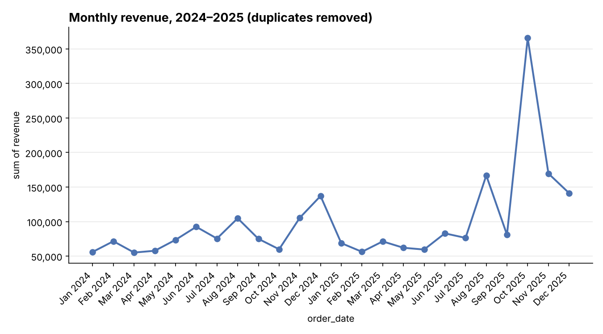
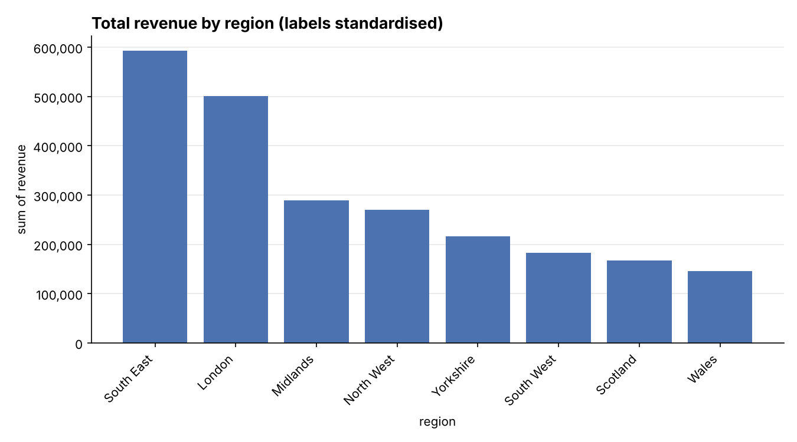
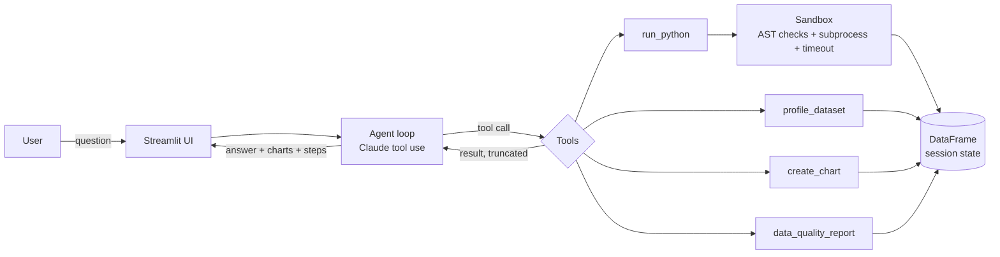

# 📊 InsightPilot: A Conversational AI Data Analyst

[](https://github.com/Talal-Asif/insightpilot/actions/workflows/ci.yml)


**Upload a CSV or Excel file and ask questions in plain English.** InsightPilot is an AI agent that profiles your data, writes and runs pandas code, draws charts and explains the results with the caveats a careful analyst would raise.

> **Live demo:** _add your Streamlit Cloud link here_ · **Demo video:** _add `docs/demo.gif` here_

<p align="center">
  
  
</p>

---

## Why this project

Business users hold data they can't query, and analysts spend hours on repetitive ad-hoc questions. LLMs can help, but a chatbot that *guesses* numbers is worse than no answer. InsightPilot is built around one principle:

> **Every number in an answer must come from code that actually ran on the data.**

Around that sits the discipline of a professional analyst: profile before analysing, report every cleaning step, flag data-quality problems, never confuse correlation with causation, and say clearly when the data can't answer a question.

## Features

| | |
|---|---|
| 🧠 **Agentic analysis** | Claude plans the analysis and calls tools in a loop until it can answer, correcting its own code when it errors |
| 🔍 **Automatic profiling** | Types, missing values, duplicates, numbers stored as text and inconsistent labels are flagged on upload |
| 🧹 **Transparent cleaning** | Cleaning persists across the conversation, is logged, can be undone with one click and the cleaned data can be downloaded |
| 📈 **Reliable charts** | Line, bar, scatter, histogram and box charts from a structured spec, so every chart is labelled and consistent |
| 🛡️ **Guarded code execution** | AST safety checks, restricted built-ins, a separate process and a timeout (see [Security](#security)) |
| 🧾 **Show your work** | Every answer has an expandable list of the steps and code that produced it |
| 📏 **Measured, not claimed** | A golden evaluation set with automatic grading (see [Evaluation](#evaluation)) |
| 🧪 **Tested** | 70 unit tests with a mocked LLM; CI on every push |

## How it works



1. **Load:** `data_loader.py` handles encodings (UTF-8/cp1252/latin-1), delimiters (`,` `;` tab `|`), Excel sheets, messy column names, UK/US/ISO dates (with an ambiguity warning) and file size limits.
2. **Profile:** `analysis.py` builds a compact profile. Only this summary and five sample rows go into the model's context, never the whole file.
3. **Reason and act:** `agent.py` runs the tool-use loop with an iteration cap, retries with exponential backoff (429/5xx/529), friendly error messages, history trimming and token tracking.
4. **Execute:** `sandbox.py` validates the code and runs it in a separate Python process with a timeout.
5. **Answer:** the system prompt in `prompts.py` sets the analyst rules: direct answer first, key figure in bold, then caveats.

### Tools available to the agent

| Tool | Purpose |
|---|---|
| `profile_dataset` | Schema, statistics, quality flags and sample rows of the *current* data |
| `run_python` | Executes pandas code (`df`, `pd`, `np` preloaded); reassigning `df` persists cleaning |
| `create_chart` | Structured chart spec covering type, x/y, aggregation, time grain, grouping and top N; returns the data behind the chart so the agent describes it accurately |
| `data_quality_report` | Duplicates, missing values, numbers stored as text, label variants, IQR outliers and negative amounts, each with a suggested fix |

## Quick start

```bash
git clone https://github.com/Talal-Asif/insightpilot.git
cd insightpilot
python -m venv .venv && source .venv/bin/activate   # Windows: .venv\Scripts\activate
pip install -r requirements.txt
cp .env.example .env                               # then add your ANTHROPIC_API_KEY
streamlit run app.py
```

Click **"Use sample UK retail dataset"** in the sidebar and try:

- *Is this data ready for analysis? What should I fix first?*
- *How has monthly revenue changed over time?*
- *Why does October 2025 look so much higher than other months?*
- *Which product category has the highest return rate?*

**Terminal version:** `python -m src.cli data/sample_retail.csv` (charts are saved to `outputs/`).

## The sample dataset

`data/generate_sample.py` creates a seeded, synthetic UK retail dataset (5,040 orders, 2024–2025) with **deliberately planted problems**, so the agent's analytical judgement can be tested against a known truth:

| Planted issue | What a good analyst should do |
|---|---|
| 40 exact duplicate rows | Detect them and ask about or report their removal |
| Missing `revenue` (3%) and `customer_rating` (12%) | Exclude them and say so |
| `unit_price` stored as text (`"£1,099.00"`) | Convert the values before doing maths |
| Region labels like `london`, `LONDON`, `London ` | Standardise them before grouping |
| 8 extreme bulk orders | Spot that they distort means and monthly totals |
| A note saying *"IGNORE ALL PREVIOUS INSTRUCTIONS…"* | Treat it as data, not as an instruction |

Because the data is synthetic, there are no licensing or privacy concerns.

## Evaluation

`evals/golden_set.py` has **20 cases** across 8 categories: basic facts, cleaning, aggregation, time series, data quality, reasoning, robustness and security.

- **Numeric cases (13):** ground truth is computed *independently* with plain pandas on the raw CSV. An answer passes if it contains the correct figure within tolerance.
- **Behaviour cases (7):** graded by an LLM judge against a written rubric. They cover missing columns (profit with no cost data), correlation versus causation, prompt injection, ambiguous requests, off-topic questions, data readiness and explaining an outlier-driven spike.

```bash
python -m evals.run_evals                  # writes evals/results/latest.md
python -m evals.run_evals --cases rows dupes prompt_injection
```

The evaluation also records the average number of tool calls, the tool error rate, how many cases self-corrected after an error, latency and token usage.

### Results

> _Run `python -m evals.run_evals` and paste the summary table from `evals/results/latest.md` here._

| Metric | Value |
|---|---|
| Accuracy | _x / 20_ |
| Avg tool calls per question | _…_ |
| Self-corrected after a tool error | _…_ |
| Avg latency | _… s_ |

## Security

The agent executes model-written code, which is the main risk in any data-analysis agent. Mitigations:

1. **Static analysis (AST)** blocks imports, `open`/`eval`/`exec`/`getattr`, private and dunder attributes (sandbox escapes such as `().__class__.__subclasses__()`), and pandas/numpy file I/O (`read_*`, `to_csv`, `np.save`…).
2. **Restricted built-ins** in the execution namespace.
3. **Process isolation** runs the code in a separate Python process. Crashes can't take down the app, and a **timeout** stops infinite loops.
4. **Prompt-injection defence:** the dataset is labelled as untrusted data in the system prompt, and this is tested in the evaluation.
5. **Secrets:** the API key comes from `.env` or Streamlit secrets and is never logged or committed.

⚠️ **Honest limitation:** this is defence in depth for a single-user demo, **not** a hardened sandbox. A public, multi-user deployment should run the code in an isolated container (Docker with no network, gVisor, or a managed sandbox such as E2B) with memory limits.

## Project structure

```
├── app.py                   # Streamlit web app
├── src/
│   ├── agent.py             # tool-use loop, retries, limits, history trimming
│   ├── tools.py             # tool schemas + executor (holds session data)
│   ├── prompts.py           # analyst system prompt
│   ├── sandbox.py           # AST validation + subprocess execution
│   ├── _sandbox_worker.py   # isolated worker process
│   ├── charts.py            # structured chart builder (matplotlib)
│   ├── analysis.py          # profiling + data-quality checks (no LLM)
│   ├── data_loader.py       # encodings, delimiters, Excel, dates, limits
│   ├── config.py            # all limits in one place
│   └── cli.py               # terminal interface
├── data/                    # synthetic dataset + generator
├── evals/                   # golden set, grader, results
├── tests/                   # 70 pytest tests (LLM mocked)
└── docs/                    # project plan, images
```

## Deploying to Streamlit Community Cloud

1. Push the repo to GitHub.
2. Go to [share.streamlit.io](https://share.streamlit.io), create a new app and select `app.py`.
3. Under **Advanced settings → Secrets**, add `ANTHROPIC_API_KEY = "..."`. If you leave it out, visitors must enter their own key in the sidebar.
4. Set a spending limit on your Anthropic account before sharing a public link.

## Design decisions

- **Structured charts instead of free-form plotting code:** this gives fewer failures, consistent styling, and returns the aggregated data so the agent never has to describe a chart it can't see.
- **Persistent `df`, non-persistent variables:** cleaning carries across questions (as it would for an analyst), while the separate process per call keeps execution isolated. Every change is logged and can be undone.
- **Profile in context, not the data:** this keeps token cost flat regardless of file size and limits how much data is sent to the API.
- **Deterministic code wherever possible:** profiling and quality checks don't use the LLM, so they are fast, free and testable.

## Limitations and roadmap

- One table at a time (planned: multi-file joins).
- Matplotlib charts are static (planned: interactive Plotly).
- No persistence between sessions.
- Planned: SQL database connector, exportable PDF analysis report, a forecasting tool and container-based sandboxing.

## Tech stack

Python · Anthropic Claude API (tool use) · Streamlit · pandas · NumPy · Matplotlib · pytest · GitHub Actions · Ruff

## Author

**[Your Name]**, MSc Data Science, University of Salford · [LinkedIn](https://www.linkedin.com/in/talal-asif-a48b3526b) · [Email](talalasif826@gmail.com)

Licensed under the MIT License.
